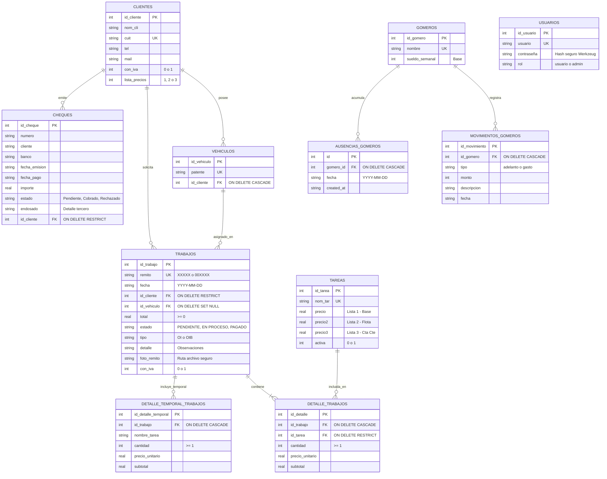
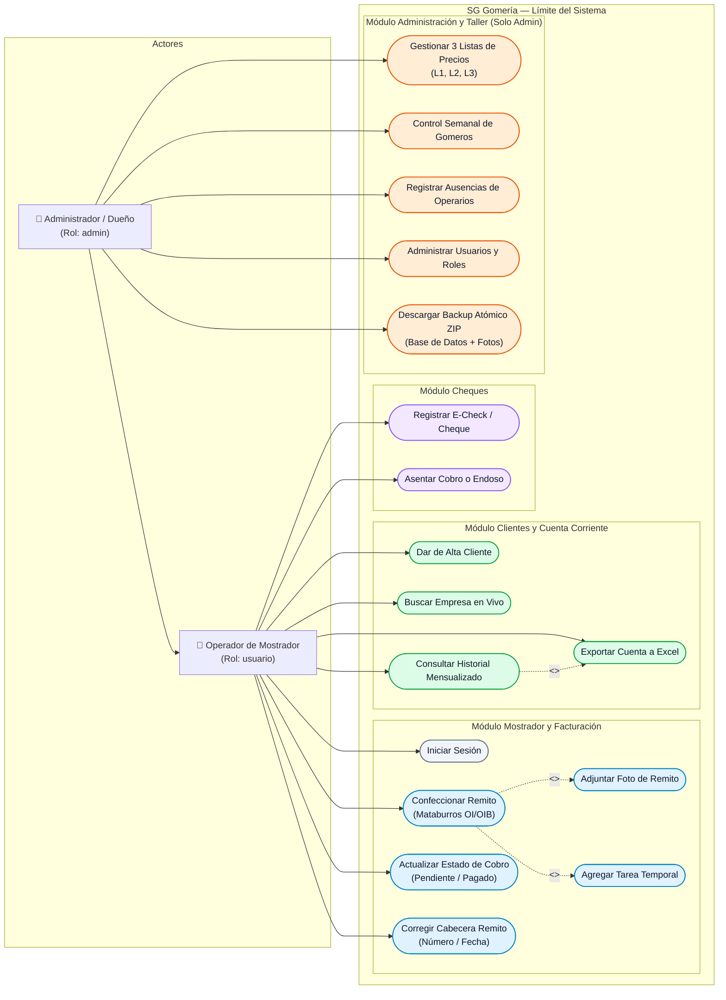

# Diagramas Técnicos: Entidad-Relación y Casos de Uso
**Sistema de Gestión — Gomería "El Puente"**  
*Cátedras: Programación 4 & Gestión de Desarrollo de Software (UTN FRGP)*

---

## 1. DIAGRAMA ENTIDAD-RELACIÓN (MER / DER)

Este modelo refleja con precisión el esquema relacional implementado en **SQLite 3** (`database/init_db.py`), incluyendo claves primarias, claves foráneas, reglas de integridad referencial (`ON DELETE`) y campos de negocio clave (listas L1-L3, condición de IVA, fotos de remitos y tareas temporales).

### Relaciones y Cardinalidades Clave:
1. **`CLIENTES (1) — (N) TRABAJOS`:** Un cliente puede tener múltiples remitos emitidos. Integridad `RESTRICT` para no borrar un cliente con historial facturado.
2. **`TRABAJOS (1) — (N) DETALLE_TRABAJOS`:** Estructura maestro-detalle donde cada renglón referencia una tarea de tarifario. Borrado en cascada (`CASCADE`).
3. **`TRABAJOS (1) — (N) DETALLE_TEMPORAL_TRABAJOS`:** Servicios esporádicos cargados directamente en el remito sin alterar el catálogo de `TAREAS`.
4. **`GOMEROS (1) — (N) AUSENCIAS_GOMEROS / MOVIMIENTOS`:** Trazabilidad de días no trabajados y adelantos para la liquidación semanal automática.

---

## 2. DIAGRAMA DE CASOS DE USO (UML)

El sistema contempla dos actores principales autenticados (**Operador de Mostrador** y **Administrador / Dueño del Taller**), además del subsistema de persistencia/seguridad.

### Especificación de Casos de Uso Principales:

| Caso de Uso | Actor | Precondición | Flujo Principal / Resultado |
| :--- | :--- | :--- | :--- |
| **Confeccionar Remito (Mataburros)** | Operador / Admin | Sesión iniciada | Selecciona cliente, carga número de remito (OI/OIB), selecciona lista (L1-L3), añade servicios, calcula IVA (21%) y guarda. Opcionalmente adjunta foto física del comprobante y tareas temporales. |
| **Actualizar Estado de Cobro** | Operador / Admin | Remito emitido | Conmuta estado entre `PENDIENTE` y `PAGADO` de forma asíncrona (AJAX/fetch) impactando de inmediato en el saldo mensual de la empresa. |
| **Exportar Cuenta a Excel** | Operador / Admin | Cliente seleccionado | Genera y descarga un libro `.xlsx` con el detalle histórico discriminado por mes, con subtotales, IVA y saldos. |
| **Control de Asistencia y Sueldos** | Solo Admin | Cierre de semana | Registra ausencias por día del gomero y el sistema descuenta proporcionalmente el valor del jornal sobre el sueldo semanal fijado. |
| **Descargar Backup Atómico** | Solo Admin | Permiso admin | SQLite ejecuta copia en caliente (`backup API`) y empaqueta la base junto a las fotos de remitos en un archivo `.zip` con timestamp descargable. |
